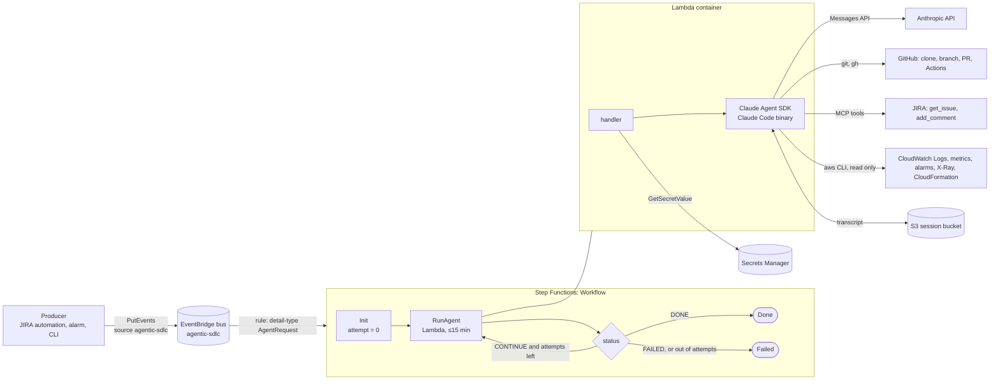
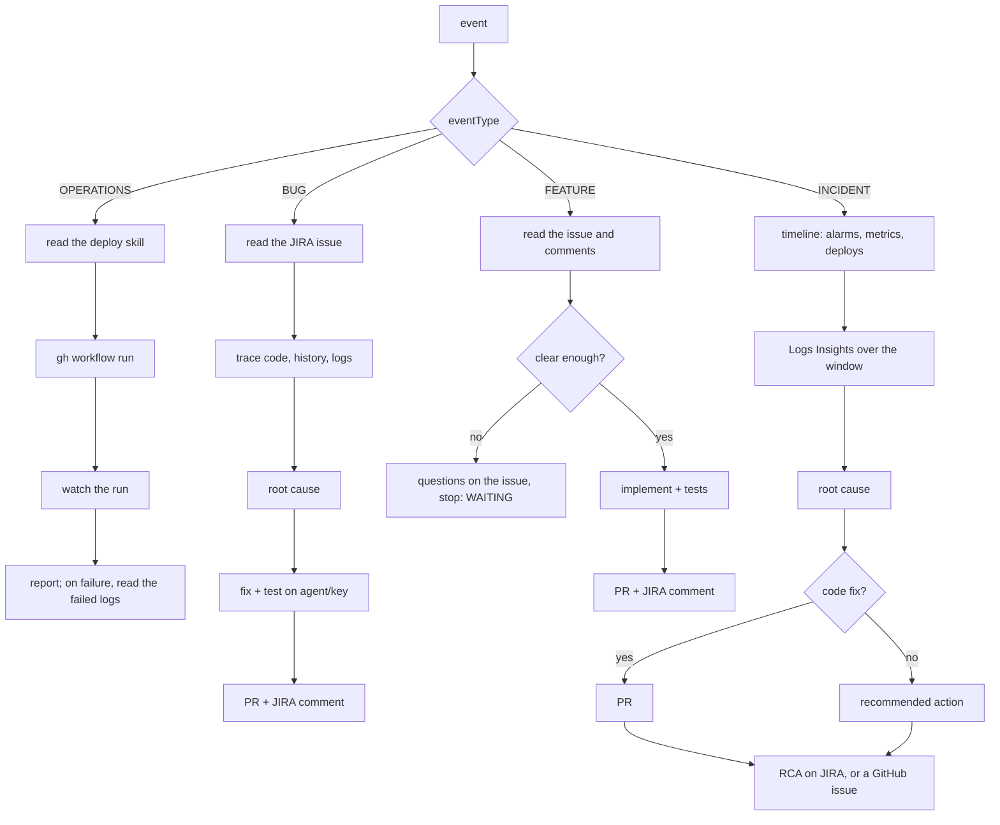

# Design: an event-driven SDLC agent on AWS Lambda

## Goal

One event names a service, its GitHub repository and a type of work. An agent running in a Lambda container picks it up, learns the repository from its own skills and docs, gathers what it needs from GitHub, JIRA and AWS, and finishes with a concrete result:

| Event type | Result |
|---|---|
| `OPERATIONS` | The repository's dev deploy workflow started, followed to the end, and reported |
| `BUG` | Root cause analysis and a pull request with the fix, linked from the JIRA issue |
| `FEATURE` | Clarifying questions on the JIRA issue, or a pull request implementing it |
| `INCIDENT` | An RCA from logs, metrics and recent deploys, and a pull request when a code fix applies |

Humans stay in the loop at the pull request: the agent never merges, never pushes to the default branch and only deploys to dev.

## Architecture

### Why the Claude Agent SDK

The Lambda runs [`@anthropic-ai/claude-agent-sdk`](https://code.claude.com/docs/en/agent-sdk/overview): Claude Code as a library. It brings the agent loop, file and shell tools, context compaction, skill discovery and session persistence, so this project only adds what is specific to it: the event contract, the four task prompts, two JIRA tools, an S3 session store and the infrastructure. Skills come for free: the SDK loads `CLAUDE.md` and `.claude/skills/*/SKILL.md` from the cloned repository (`settingSources: ["project"]`, `skills: "all"`), so each repository teaches the agent how it is built, tested, deployed and observed.

## Event contract

The input of the state machine, or the `detail` of an EventBridge event with source `agentic-sdlc` and detail-type `AgentRequest`.

| Field | Required | Meaning |
|---|---|---|
| `serviceName` | always | Name of the service, used in prompts and reports |
| `repoUrl` | always | `https://github.com/<owner>/<repo>`; must be in `allowedRepos` |
| `eventType` | always | `OPERATIONS`, `BUG`, `FEATURE` or `INCIDENT` |
| `jiraKey` | `BUG`, `FEATURE`; optional for `INCIDENT` | The JIRA issue, such as `ABC-123` |
| `incident` | `INCIDENT` | `{ description, alarmName?, startTime?, endTime? }`, times in ISO 8601 |
| `ref` | optional, `OPERATIONS` | Branch or tag to deploy; default is what the repository's docs name |

Validation is in [`agent/src/event.ts`](agent/src/event.ts). A repository outside the allowlist is refused before any credential is used.

## The four paths

Each path is a short prompt in [`agent/prompts/`](agent/prompts), appended to the general rules in [`system.md`](agent/prompts/system.md). The prompts state the outcome and the order of work; the repository's skills supply the specifics.

A `FEATURE` that waits for answers ends its execution. Send the same event again once the questions are answered: the agent re-reads the issue with its comments and continues on the same branch.

## Running past 15 minutes

A Lambda invocation stops at 15 minutes; a bug fix or an RCA can take longer. Each invocation is one attempt, and Step Functions loops attempts:

1. The handler gives the agent the invocation's remaining time minus two minutes (or `maxRunMs`), then aborts it.
2. The conversation survives in S3: the SDK mirrors the transcript to the session bucket through [`S3SessionStore`](agent/src/S3SessionStore.ts), and the next attempt passes `resume: sessionId`. The working directory is always `/tmp/repo`, because the store keys transcripts by it.
3. The files survive in git: the handler, not the model, commits what is left and pushes it to the work branch `agent/<jiraKey>` (or `agent/<execution name>`). The next attempt clones the repository again and checks the branch out.
4. The Lambda returns `DONE` (the agent finished), `CONTINUE` (stopped at the time or turn limit) or `FAILED`. The state machine runs another attempt on `CONTINUE` until `maxAttempts` (default 6, about 90 minutes), then fails for a human.

The same branch logic makes re-sent events idempotent: a second `BUG` event for the same issue continues on `agent/<key>` and updates its pull request.

## Credentials and permissions

| Credential | Where | Scope |
|---|---|---|
| Anthropic API key | Secrets Manager `agentic-sdlc/config` | Model calls |
| GitHub fine-grained PAT | same secret, `GITHUB_TOKEN` | Only the target repositories: Contents, Pull requests, Actions, Issues (read and write) |
| JIRA API token | same secret, `JIRA_BASE_URL`, `JIRA_EMAIL`, `JIRA_API_TOKEN` | The JIRA tools read and comment on the event's issue only |
| AWS | Lambda role | CloudWatch and X-Ray read only, CloudFormation describe, the secret, the session bucket |

Agent SDK settings ([`handler.ts`](agent/src/handler.ts)): `permissionMode: "dontAsk"` with an allowlist of Read, Edit, Write, Glob, Grep, Bash and the two JIRA tools; WebFetch and WebSearch removed; a budget per attempt (`maxBudgetUsd`, default $20) and a turn limit (200).

## Configuration

CDK context (`-c key=value`):

| Key | Default | Meaning |
|---|---|---|
| `allowedRepos` | required | Comma-separated `owner/repo` list |
| `secretName` | `agentic-sdlc/config` | The secret described above |
| `model` | `claude-opus-5-5` | Model for the agent |
| `maxAttempts` | `6` | Lambda attempts per task |
| `maxBudgetUsd` | `20` | Spend limit per attempt, in USD |
| `maxRunMs` | none | Stop each attempt earlier, to test resuming |
| `stackName` | `AgenticSdlc` | CloudFormation stack name |

## Risks and limits

- **Prompt injection.** Ticket text, comments and logs are untrusted input to an agent with a shell, open internet egress and tokens that can push branches and start deploy workflows. The tokens are also readable from the agent's shell. Branch protection on the default branch, pull request review and GitHub environment rules limit the damage; they do not remove it. Upgrades: a GitHub App with one-hour tokens, an egress proxy with an allowlist, and a separate read-only role for the agent's `aws` CLI.
- **The target repository controls the agent.** `settingSources: ["project"]` loads its `.claude/settings.json`, hooks included. Allow only repositories whose write access you trust.
- **Dev-only deploys are enforced by the prompt**, not by code. Protect every other GitHub environment with required reviewers.
- **Logs may hold personal data.** The role can read every log group in the account; the prompts ask the agent to strip personal data from what it quotes.
- **Toolchains.** The image has Node.js 24, git, `gh` and the AWS CLI. Repositories that need other runtimes, Docker or a local stack for their tests get a pull request whose body says which tests did not run.
- **Long deploy workflows.** `OPERATIONS` follows the workflow inside the attempt loop, about 90 minutes at most; a longer run ends with its URL and "still running". A Step Functions wait loop is the upgrade.
- **Not built yet:** adapters that turn JIRA webhooks or CloudWatch alarms into events, a lock against two executions for the same issue, JIRA status transitions, OpenTelemetry export.
